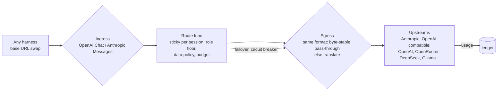
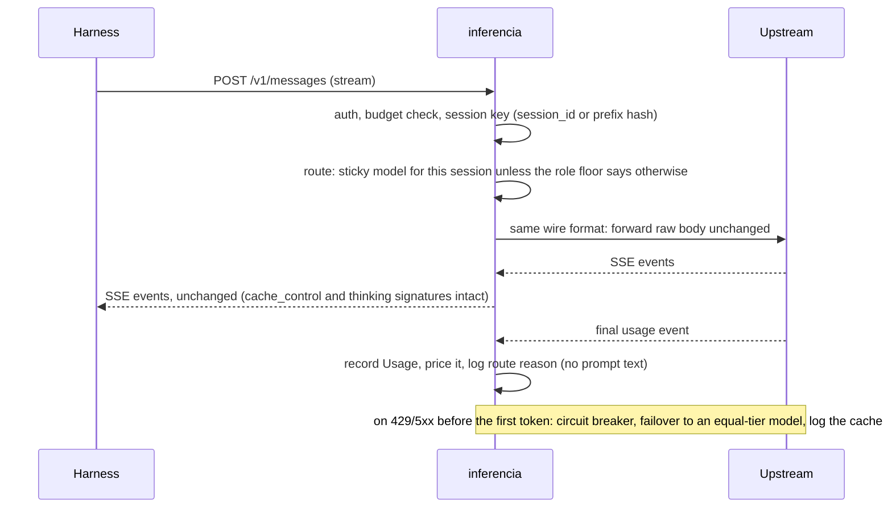

# Inferencia v4: a senior developer's guide

> Status: DRAFT while the gauntlet runs. Sections 5-7 and 10 fill in from the E3 pilot and Gate 1.
> Every number links to an evidence file. Dollar figures are list-price estimates unless a section
> says otherwise.

## 1. What inferencia is, and is not

Inferencia is a cost router and a cost ledger for AI coding work. It reads the logs your coding
harnesses already write (Claude Code, Codex CLI, OpenCode, Command Code), tells you what that work
cost and would have cost on other models, and, in its gateway form, sits under a harness as a
base-URL swap to pick the model for each session. It is not a harness: it never owns the agent loop,
the tools or the UI. It never proxies a subscription login: flat plans are measured, and work goes to
them only through their own official clients. The north star is cost per accepted task at the
quality of the best single model, with orchestration overhead included.

## 2. Architecture

What exists after the gauntlet's measurement stages (S1-S2, E2): a read-only pipeline from harness
logs to reports. No request passes through it.

```mermaid
flowchart LR
  subgraph logs [Harness logs, read-only]
    CC[Claude Code<br/>~/.claude/projects JSONL]
    CX[Codex CLI<br/>~/.codex/sessions JSONL]
    OC[OpenCode<br/>opencode.db via sqlite3 -readonly]
    CM[Command Code<br/>~/.commandcode/projects JSONL]
  end
  CC & CX & OC & CM --> A[Adapters<br/>func(root, Window) ([]Usage, error)]
  A --> U[[ledger.Usage<br/>one normalized record]]
  U --> M[measure<br/>spend, cache share, solo vs delegated]
  U --> P[catalog.Model.Cost<br/>the one price function]
  CAT[(catalog.yaml<br/>sourced list prices, plans)] --> P
  P --> S[savings<br/>same tokens, other models]
  P --> SB[subs<br/>plan value per month]
  P --> R[replay<br/>routing policies + cache loss]
```

The planned gateway (S4) puts the same price function in the request path:



One request's lifecycle in the gateway, streaming included:



## 3. Design choices

| Choice | Alternatives rejected | Pros | Cons | Evidence |
| --- | --- | --- | --- | --- |
| Measure first, route later | Build the gateway first | No request risk; finds where money goes before building | Nothing saves money until routing exists | [S1](gauntlet/evidence/S1.md): 96-98% cache reads, near-zero chatter |
| One `Usage` record, adapters as plain functions | An adapter interface, a plugin registry | Four sources, one shape, no indirection; each adapter tests alone | A new source means a new function (by design) | [S1](gauntlet/evidence/S1.md) |
| Read OpenCode through the `sqlite3` CLI | A Go SQLite driver now | Zero new dependencies | Needs `sqlite3` on PATH | [D2](gauntlet/DECISIONS.md) |
| One price function that fails loud | Default unknown prices to $0 | A wrong total is impossible to miss | Reports list unpriced models you must add | [S2](gauntlet/evidence/S2.md) |
| Catalog with a source URL on every price | Hard-coded prices, a pricing API | Every number is auditable | Prices go stale; `as_of` says how stale | [catalog.yaml](../internal/catalog/catalog.yaml) |
| Split 5-minute and 1-hour cache writes | One cache-write price | Claude Code writes the 1-hour cache at 2x input, not 1.25x | One more field | [S2](gauntlet/evidence/S2.md) |
| Long-context prices per request | Ignore them | Haiku 5.5 costs 5x over 100k prompt tokens; nearly all coding calls are over | Per-call average for whole-session Codex records | [S2](gauntlet/evidence/S2.md) |
| Sticky per session, switch only on failover | Route per call | A mid-session switch re-writes the cache; a naive router can cost more than none (1.16x) | Gives up per-call savings | [E2](gauntlet/experiments/E2/README.md) |
| Rules before a learned scorer (Laya/Jev) | A learned router in the hot path | Explainable (`why <id>`), no model call to route | May leave savings unclaimed | RouteLLM needs in-domain data ([plan](PLAN_V4.md)) |
| SQLite step log with Temporal's semantics | Run Temporal | One binary on a Pi; resume never re-spends tokens | No multi-node workers | [plan](PLAN_V4.md), Durable execution |
| Subscription-first through official clients | Proxy plan logins | Stays inside provider terms; plans are 25-31x value | Quota is a shared, invisible budget | [E4](gauntlet/experiments/E4/README.md) |
| Fail-open means "fall back to a default provider" | Skip auth or budgets when degraded | Outages never become a cost attack | A default provider must be configured | [plan](PLAN_V4.md), Security |
| Tests as the visible spec in E3 | Hidden tests graded on unstated API shapes | Measures engineering, not guessing | Agents see the target behavior | [D6](gauntlet/DECISIONS.md) |

## 4. The Go interfaces

The measurement code has **no interfaces at all**. Every adapter is
`func(root string, w Window) ([]Usage, error)`; `Load` holds them in a slice of structs with a
function field. The one place behavior varies by kind, the price, is data (`catalog.yaml`), not code.

The gateway core (S4) adds one:

```go
type Provider interface {
	Do(ctx context.Context, r *Request) (*Response, error)
}
type Route func(r *Request, c []Candidate) []Candidate
```

- **Why one method.** Streaming and non-streaming differ only in how the body is read, so the
  response carries an `io.ReadCloser`. The repo's old `Backend` interface had six methods and two of
  them (`ChatCompletion`, `ChatCompletionStream`) were the same call.
- **Why `Route` is a function.** Policies are values: `replay.AsRun`, `replay.Floor(model)`,
  `replay.MainOn(set, model)`, `replay.NaivePerCall(...)` are all `Policy` functions, testable without
  a router.
- **Errors are values.** `catalog.ErrUnknownModel`, `ErrMissingPrice`, `ErrBadUsage`, and
  `ledger.PartialError` (records read plus a count of what could not be read) let callers branch with
  `errors.Is`/`errors.As` instead of string matching.
- **Interfaces that do not exist on purpose:** ProviderFactory, PluginRegistry, a Middleware interface
  (middleware stays `func(http.Handler) http.Handler`), a Cache interface, a Repository over SQLite, an
  EventBus, a workflow-engine abstraction, a Translator class tree, and a Scorer interface (a func
  type until a second real scorer exists).

## 8. Security model

| Threat (OWASP LLM 2025) | Control | Test |
| --- | --- | --- |
| Logs leak secrets or prompts | Adapters decode into typed structs that drop text; reports print only model names and counts; control characters stripped | `strips control characters`; no text fields in `Usage` |
| Writing to a harness's data | Files opened read-only; OpenCode read with `sqlite3 -readonly`, fixed query, message and session tables only | by construction; reviewed in [S1](gauntlet/evidence/S1.md) |
| Credential tables | The query never touches OpenCode's credential or account tables; no `auth.json` is opened | [GAUNTLET.md](GAUNTLET.md) rule 9 |
| Cost attack (LLM10) | Unknown prices fail loud; budgets in S4 | `TestUnknownModelFailsLoud` |
| Untrusted code in experiments | E3 runs tasks in fresh repos with no history, tests in a sandbox with a temp HOME and no credentials; dependencies must match `go.sum` | [build_suite.sh](gauntlet/experiments/E3/build_suite.sh) |
| Plan quota exhaustion | E3 driver stops at 60% of the 7-day plan window | [run_pilot.sh](gauntlet/experiments/E3/run_pilot.sh) |
| Prompt injection, credential passthrough, SSRF, fail-open bypass | Gateway controls (S4): route on request shape only, keys server-side, private ranges blocked, fail-open never skips auth or budgets | E9 (S4 exit) |

## 9. Questions a senior developer should ask

- **What happens when a harness changes its log format?** The adapter counts unreadable lines and
  says so (`PartialError`); the golden-number test (`INFERENCIA_GOLDEN=1`) catches silent drift.
- **What does it cost to run?** Measurement: nothing; it is a CLI over local files. The gateway: one
  Go binary on the existing Pi.
- **What breaks at 10x traffic?** `measure` reads every log on each run (2 s today for 27,508 calls);
  at 10x it wants the persistent ledger from D5. The gateway's ledger write path is the next limit.
- **Vendor-change risk?** Prices live in data with sources and dates; a price change is a YAML edit.
  Harness formats are the real risk, covered above.
- **What history are you losing right now?** Claude Code deletes old transcripts: the logs on disk hold
  23 days up to 2026-09-30 ([F1](gauntlet/evidence/S1.md)). Raise its retention setting.
- **How do you delete it cleanly?** `measure`, `savings`, `subs` and `replay` write nothing. Remove the
  binary. The gateway, when built, is one base-URL setting to revert (`inferencia off`).
