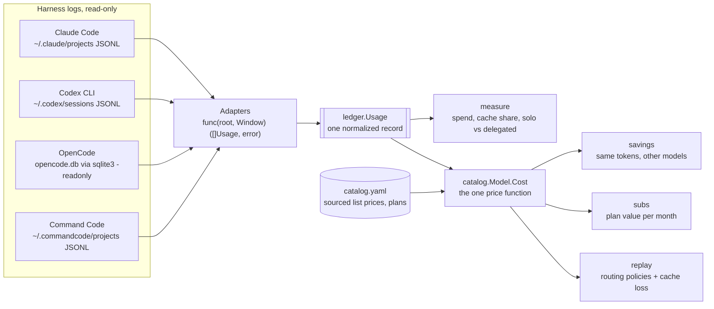
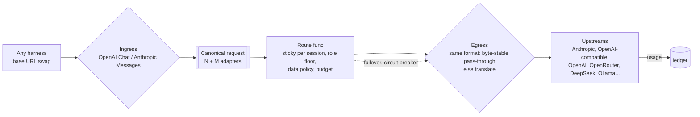
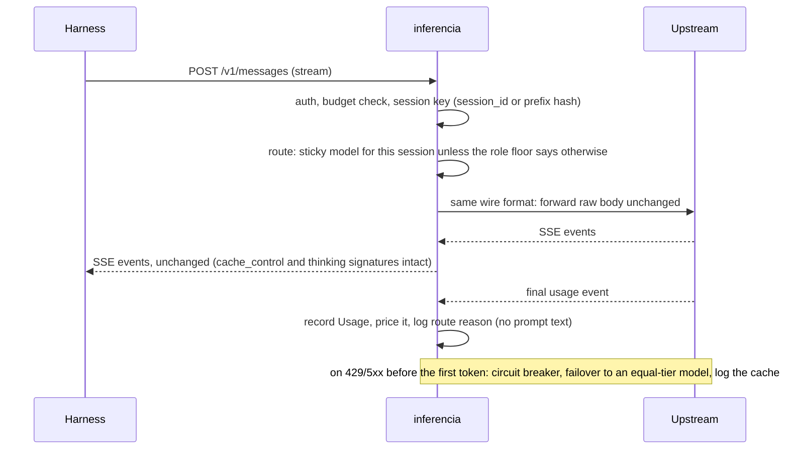
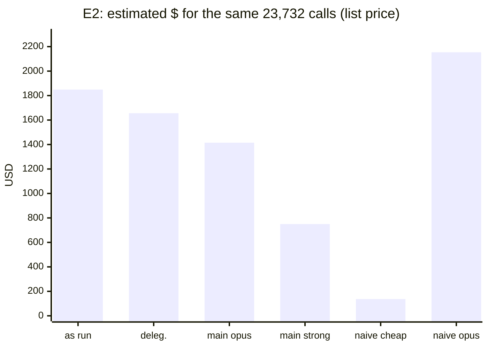
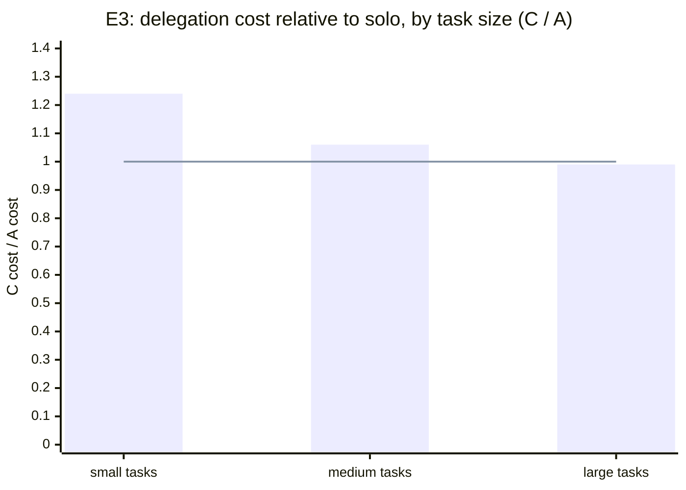
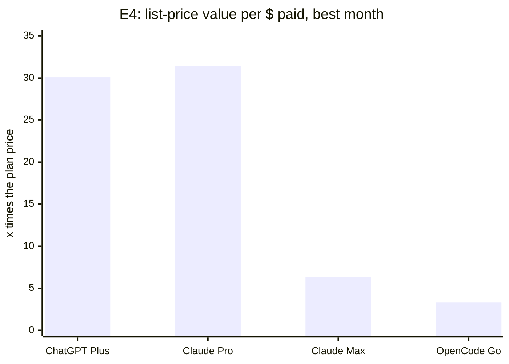

# Inferencia v4: a senior developer's guide

> Written at the end of the v4 gauntlet (2026-10-17, branch `gauntlet/v4`). Numbers link to their
> evidence where they first appear; the summary repeats figures from [GATE1](gauntlet/GATE1.md),
> [E2](gauntlet/experiments/E2/README.md) and [E4](gauntlet/experiments/E4/README.md). Dollar figures are list-price, API-equivalent estimates unless a line says otherwise;
> they are not bills (the bill check, E1, was skipped: no API key was available).

**The short version.** Inferencia v4 is a read-only cost ledger for AI coding work across Claude Code,
Codex, OpenCode and Command Code. Its measurements were tested hard, and the headline is not the one
the project started with. Delegating work from a frontier model to cheap workers matched a solo
frontier model on quality but **did not lower cost per accepted task** (1.01x, 95% CI 0.84-1.17). The
money is in two other places the ledger found: **which model runs the main loop** (0.76x by staying in
the same tier, 0.39x-0.41x a tier down, quality untested) and **flat plans** (25-31x list value on
$20 plans). So Gate 1 failed, the gateway and delegate engine were not built, and the ledger ships alone.

## 1. What inferencia is, and is not

Inferencia is a cost ledger and, by design, a cost router for AI coding work. It reads the logs your
coding harnesses already write and tells you what that work cost and would have cost on other models.
In its gateway form (designed, not built, see section 3) it would sit under a harness as a base-URL
swap and pick the model per session. It is not a harness: it never owns the agent loop, the tools or
the UI. It never proxies a subscription login: plans are measured, and work goes to them only through
their own official clients. The north star is cost per accepted task at the quality of the best single
model, orchestration overhead included.

## 2. Architecture

What exists: a read-only pipeline from harness logs to reports. No request passes through it.



The designed gateway (not built, because Gate 1 failed) would put the same price function in the
request path:



One request's lifecycle in that gateway, streaming included:



## 3. Design choices

| Choice | Alternatives rejected | Pros | Cons | Evidence |
| --- | --- | --- | --- | --- |
| Measure first, route only if measurement says so | Build the gateway first | Found that delegation does not pay before building it | Nothing routes yet | [GATE1](gauntlet/GATE1.md) |
| One `Usage` record, adapters as plain functions | An adapter interface, a plugin registry | Four sources, one shape, no indirection | A new source is a new function (by design) | [S1](gauntlet/evidence/S1.md) |
| Read OpenCode through the `sqlite3` CLI | A Go SQLite driver now | Zero new dependencies | Needs `sqlite3` on PATH | [D2](gauntlet/DECISIONS.md) |
| One price function that fails loud | Default unknown prices to $0 | A wrong total cannot hide | Reports list unpriced models you must add | [S2](gauntlet/evidence/S2.md) |
| A source URL on every price | Hard-coded prices, a pricing API | Every number is auditable | Prices go stale; `as_of` says how stale | [catalog.yaml](../internal/catalog/catalog.yaml) |
| Split 5-minute and 1-hour cache writes | One cache-write price | Claude Code writes the 1-hour cache at 2x input, not 1.25x | One more field | [S2](gauntlet/evidence/S2.md) |
| Long-context prices per request | Ignore them | Haiku 5.5 costs 5x over 100k prompt tokens; about 90% of Claude Code calls are over | Per-call average for whole-session Codex records | [S2](gauntlet/evidence/S2.md) |
| Sticky per session, switch only on failover | Route per call | A naive per-call router cost 1.16x of no router with an expensive target | Gives up per-call savings | [E2](gauntlet/experiments/E2/README.md) |
| Rules before a learned scorer (Laya/Jev) | A learned router in the hot path | Explainable (`why <id>`), no model call to route | May leave savings unclaimed | [plan](PLAN_V4.md) |
| Temporal's semantics in a SQLite step log | Run Temporal | One binary on a Pi; resume never re-spends tokens | No multi-node workers | [plan](PLAN_V4.md), Durable execution |
| Subscription-first through official clients | Proxy plan logins | Inside provider terms; plans are 25-31x value | Quota is a shared, invisible budget | [E4](gauntlet/experiments/E4/README.md) |
| Fail-open means a default provider | Skip auth or budgets when degraded | Outages never become a cost attack | A default provider must be configured | [plan](PLAN_V4.md), Security |
| Tests as the visible spec in E3 | Hidden tests on unstated API shapes | Measures engineering, not guessing | Agents see the target behavior | [D6](gauntlet/DECISIONS.md) |
| Gate before building | Build S4/S5 anyway | Avoided building the gateway and delegate engine for a saving the pilot did not find | The router is still a design | [GATE1](gauntlet/GATE1.md) |
| One canonical request format, N + M adapters (designed) | A translator per harness-provider pair (N x M) | Adding a harness or a provider is one adapter | Translation fidelity must be proven per pair (E8) | [plan](PLAN_V4.md), Where inferencia sits |
| No persistent ledger yet; read the logs each run | A SQLite ledger now | Nothing to migrate or corrupt; always matches the logs | History vanishes when a harness deletes logs (F1) | [D2, D5](gauntlet/DECISIONS.md) |

## 4. The Go interfaces

The v4 ledger code (`ledger`, `catalog`, `replay`) has **no interfaces**. Every adapter is `func(root string, w Window) ([]Usage,
error)`; `Load` holds them in a slice of structs with a function field. Routing policies are values of
`type Policy func(u ledger.Usage, prev string) string` (`replay.AsRun`, `Floor`, `MainOn`,
`NaivePerCall`), testable without a router. The one place behavior varies by kind, the price, is data.

The designed gateway core would add one:

```go
type Provider interface {
	Do(ctx context.Context, r *Request) (*Response, error)
}
type Route func(r *Request, c []Candidate) []Candidate
```

- **Why one method.** Streaming and non-streaming differ only in how the body is read, so the response
  carries an `io.ReadCloser`. The repo's old `Backend` interface has six methods, two of them the same call.
- **Errors are values.** `catalog.ErrUnknownModel`, `ErrMissingPrice`, `ErrBadUsage`, and
  `ledger.PartialError` (records read plus a count of what could not be read) let callers branch with
  `errors.Is`/`errors.As`.
- **Interfaces that do not exist on purpose:** ProviderFactory, PluginRegistry, a Middleware interface
  (middleware stays `func(http.Handler) http.Handler`), a Cache interface, a Repository over SQLite, an
  EventBus, a workflow-engine abstraction, a Translator class tree, a Scorer interface.

## 5. The experiments

### S1: what the logs say ([evidence](gauntlet/evidence/S1.md))

| Harness | Calls | Input tokens | Cache-read share | Harness $ |
| --- | --- | --- | --- | --- |
| claude-code | 14,877 | 4.12B | 98.2% | - |
| codex | 3,394 events (8 sessions) | 444.9M | 96.1% | - |
| opencode | 8,733 | 1.79B | 98.2% | $51.95 (mostly notional, plan) |
| command-code | 504 | 95.1M | 70.1% | $3.32 |
| all | 27,508 | 6.46B | 97.6% | partial |

Golden numbers reproduce within 2% for OpenCode (8,733 calls, $51.95), Codex (96.1% cache) and Command
Code (504 calls, $3.32 vs $3.33). Not reproducible: the plan's 12,247 Claude calls to 2026-09-30, because
Claude Code deleted older transcripts (6,713 remain; finding F1). Threats: logs only, and a harness that
logs no tokens (Gemini CLI) is invisible.

### E2: re-pricing recorded sessions under routing policies ([evidence](gauntlet/experiments/E2/README.md))



| Policy | Est. $ | vs as run | Mid-session switches | Cache loss $ |
| --- | --- | --- | --- | --- |
| as run | 1,849 | 1.00x | 0 | 0 |
| delegated work -> deepseek-v4-pro | 1,656 | 0.90x | 0 | 0 |
| main loop off frontier -> claude-opus-5-5 (same tier) | 1,415 | 0.76x | 0 | 0 |
| main loop off frontier -> deepseek-v4-pro | 750 | 0.41x | 0 | 0 |
| naive per-call router, cheap large-call target | 137 | 0.07x | 308 | 7 |
| naive per-call router, claude-opus-5-5 target | 2,154 | 1.16x | 308 | 233 |

Shown: the main-loop model is the lever; delegation alone moves about 10%; a router that switches models
mid-conversation can cost more than no router. Threats: list prices; same token counts on another model;
quality not modeled; default targets cherry-picked as cheapest on the same data.

### E3: the live paired pilot ([evidence](gauntlet/experiments/E3/README.md), [gate](gauntlet/GATE1.md))



| Arm | Accepted | $ per accepted | Ratio vs A [95% CI] | Quality |
| --- | --- | --- | --- | --- |
| A solo claude-opus-5-5 | 27/31 | 0.86 | 1.00 | baseline |
| B routed by harness config | 27/31 | 0.88 | 1.03 [0.98, 1.09] | non-inferior |
| C delegated to DeepSeek workers | 28/31 | 0.86 | 1.01 [0.84, 1.17] | non-inferior |

Disproved: that delegation lowers cost per accepted task on this kind of work. Arm C's cost was 93% the
Opus orchestrator, which spent 97% of what doing the change alone cost; the workers cost $1.65 in total.
Also disproved: that routing subagents by config changes cost here; no B run spawned a subagent.
Threats: small tasks (median 2 minutes); two repos; tests visible as the spec; two tasks unsolvable in
every arm; API-equivalent cost, not a bill.

### E4: subscription value ([evidence](gauntlet/experiments/E4/README.md))



You are almost certainly on OpenCode Go ($10): in July, Kimi K3 stopped at $15.05 of allowance, its Go
cap. Subscription-first dispatch would have avoided $10.73 of per-token spend that plans already covered.
Threats: list prices; plan limits are published ranges; Claude's Max is listed only from $100.

### E1: ledger vs a bill: skipped

No billed source was reachable (no OpenRouter or provider key exported). Price tables disagree: OpenCode
prices deepseek-v4-flash about 5x below OpenRouter's list ([S2](gauntlet/evidence/S2.md)).

## 6. Inferencia vs no inferencia

| | No inferencia (solo frontier) | Inferencia delegation (arm C) | Inferencia config routing (arm B) |
| --- | --- | --- | --- |
| Cost per accepted task ([GATE1](gauntlet/GATE1.md)) | $0.86 | $0.86 (1.01x) | $0.88 (1.03x) |
| Accept rate | 87% | 90% | 87% |
| Median time per task | 2.0 min | 3.9 min | 1.9 min |

What inferencia is worth today is the ledger, not the router: it showed that the money sits in the
main-loop model choice and in plans, and it stopped a gateway from being built for a saving that is not
there. Running live, delegation costs the same and takes twice as long.

## 7. Subscriptions: how far the $20 plans go

At list prices, October's Codex work on gpt-6-astra was worth $602.71 (30x a $20 Plus plan) and Claude
Code's was worth $628.00 (31x Pro, 6.3x Max from $100), in half a month. Claude Code bills to a plan: its
stream reports 5-hour and 7-day utilization ([D7](gauntlet/DECISIONS.md)). Spill-over to per-token APIs
starts at plan limits, not price: peak Codex use was 14 gpt-6-astra turns in a 5-hour window, near the
low end of Plus's 5-45 range, so Plus would likely throttle at peak. The E3 pilot itself, 93 agent runs,
used 21% of a 7-day Claude window.

## 8. Security model

| Threat (OWASP LLM 2025) | Control | Test |
| --- | --- | --- |
| Logs leak secrets or prompts (LLM02) | Adapters decode into typed structs that drop text; reports print model names and counts; control characters stripped | `strips control characters`; no text fields in `Usage` |
| Writing to a harness's data (LLM06, excessive agency) | Read-only file opens; OpenCode via `sqlite3 -readonly`, fixed query, message and session tables only | design review only, no test ([S1](gauntlet/evidence/S1.md)) |
| Credential tables (LLM02) | OpenCode's credential and account tables and every `auth.json` are never opened | rule only, no test ([GAUNTLET.md](GAUNTLET.md) rule 9) |
| Cost attack (LLM10) | Unknown prices fail loud | `TestUnknownModelFailsLoud` |
| Untrusted code in experiments (LLM03, LLM05) | Fresh repos with no history; OS sandbox for the agent's shell (no reads under home, no network); `sandbox-exec` for workers and grading | live probe in [E3 review](gauntlet/evidence/E3-harness-review.md) |
| Plan quota exhaustion (LLM10) | Pilot stops at 60% of the 7-day window; fails closed without a signal | [run_pilot.sh](gauntlet/experiments/E3/run_pilot.sh) |
| Prompt injection (LLM01), credential passthrough (LLM02), SSRF, fail-open bypass (LLM10) | Gateway controls (designed, not built) | E9, skipped with S4 |

## 9. Questions a senior developer should ask

- **Did the experiment measure what it claims?** It was reviewed adversarially before running: 3 blockers
  (answer leakage, unsandboxed agent code, timeouts counted as $0) and 8 majors were fixed, and a live
  probe confirmed the isolation ([review](gauntlet/evidence/E3-harness-review.md)).
- **What happens when a harness changes its log format?** The adapter counts unreadable lines
  (`PartialError`); `INFERENCIA_GOLDEN=1` catches silent drift.
- **What does it cost to run?** Nothing: a CLI over local files. The E3 pilot cost about $71 of
  API-equivalent plan usage, which includes $1.65 of DeepSeek worker tokens billed through Command Code's
  provider API (an estimate at list price; [spend.csv](gauntlet/spend.csv)).
- **What breaks at 10x?** `measure` reads every log each run (about 2 s for 27,508 calls,
  [S1](gauntlet/evidence/S1.md)); at 10x it wants a persistent ledger ([D5](gauntlet/DECISIONS.md)).
- **What history are you losing?** Claude Code deletes old transcripts; raise `cleanupPeriodDays`
  ([F1](gauntlet/evidence/S1.md)).
- **What else did the gauntlet find?** A real router bug: equal-load round-robin was not round-robin,
  because candidate order came from a map (fixed in 4473f88; F7).
- **How do you delete it cleanly?** The reports write nothing. Remove the binary.

## 10. Open risks and the next three experiments

Risks: list prices are not bills; tasks were small and from two repos; one orchestrator and one worker
model; plan limits are published ranges, not contracts.

1. **Main-loop model swap, live.** E2 says moving the main loop off its frontier model is the largest
   lever (0.76x within the tier, about 0.4x a tier down). Run the E3 harness with arm A on gpt-6-astra
   vs claude-opus-5-5 vs a strong-tier model, and measure accept rate.
2. **Delegation on large work.** The trend reached 0.99x on the largest third. Build a suite of
   multi-hour features and repeat arm C vs A; delegation can only win where the orchestrator's share
   shrinks.
3. **Ledger vs a bill (E1).** Export an OpenRouter key and compare the ledger with its per-generation
   cost; settle which price table is right.
